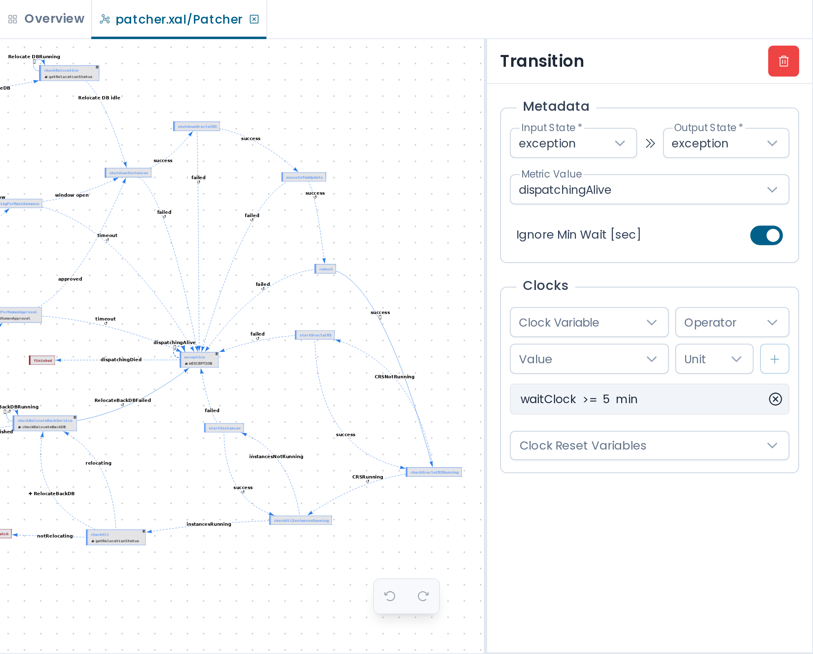

# Metric Value e Clock

Il campo **Metric Value** e la sezione **Clocks** del pannello della transizione decidono quando una transizione scatta. Puoi usarli da soli o insieme.

/// caption
Fig.1 - Un self-loop su exception: Metric Value, Ignore Min Wait e un vincolo Clock
///

---

## Metric Value

Il **Metric Value** è il valore che la Metric dello stato di input deve restituire perché la transizione scatti. C'è sulle Transition, non sulle TransitionNew.

Sceglilo dalla lista. Le opzioni sono i valori dichiarati sulla Metric dello stato di input (vedi [Configurare le Metric degli stati](../states/metrics.md)). Se lo stato di input non ha una Metric, o la sua Metric non dichiara valori, la lista è vuota.

Senza Metric Value la transizione non guarda la Metric: scatta appena i suoi vincoli Clock sono soddisfatti.

!!! warning
    Due transizioni dallo stesso stato di input non possono avere lo stesso Metric Value e gli stessi vincoli Clock: l'automa non saprebbe quale prendere. In quel caso il campo mostra **Metric value already in use**.

---

## Vincoli Clock

Un vincolo Clock fa aspettare la transizione per un certo tempo, o smettere di aspettare dopo un certo tempo. Confronta un Clock dell'automa con un valore: `waitClock >= 5 min` è vero quando sono passati cinque minuti dall'ultimo azzeramento di `waitClock`.

Per aggiungerne uno, nella sezione **Clocks**:

1. scegli la **Clock Variable**: i Clock dell'automa (vedi [Variabili Clock](../automata/clocks.md));
2. scegli l'**Operator**: `<`, `<=`, `>` o `>=`;
3. in **Value** scrivi un numero intero, oppure scegli un Global State dell'automa per confrontare con il suo valore;
4. se vuoi, scegli la **Unit**: `sec`, `min` o `hour`. Senza unità il valore è in secondi;
5. clicca **+**.

Il pulsante **+** resta disattivato finché Clock, operatore e valore non sono impostati. Un valore che non è né un numero né un Global State mostra **Value must be a number or a global state**.

Il vincolo compare sotto come chip; se contiene un Global State ne mostra l'icona. Per togliere un vincolo, clicca **×** sul suo chip.

Una transizione può avere più vincoli Clock: devono essere tutti soddisfatti nello stesso momento.

---

## Clock Reset Variables

**Clock Reset Variables** elenca i Clock da far ripartire da zero quando la transizione scatta. Scegli uno o più Clock dell'automa; ognuno compare come un'etichetta che puoi togliere.

Azzera un Clock sulla transizione che entra nella fase di attesa, e mettilo nei vincoli delle transizioni che ne escono.

---

## Ignore Min Wait

L'interruttore **Ignore Min Wait** fa scattare la transizione senza aspettare il min wait dell'automa. Vedi [Min Wait e Ignore Min Wait](types.md#min-wait-e-ignore-min-wait).

---

## Combinare le condizioni

Quando una transizione ha sia un Metric Value sia dei vincoli Clock, devono valere entrambi: la Metric ha restituito quel valore e tutti i vincoli sono soddisfatti.

Uno schema comune è il timeout: una transizione gestisce il valore atteso, un'altra lascia lo stato quando un Clock supera un limite. In Fig.1 il self-loop su **exception** scatta solo quando la Metric restituisce `dispatchingAlive` e `waitClock` ha raggiunto i cinque minuti.
