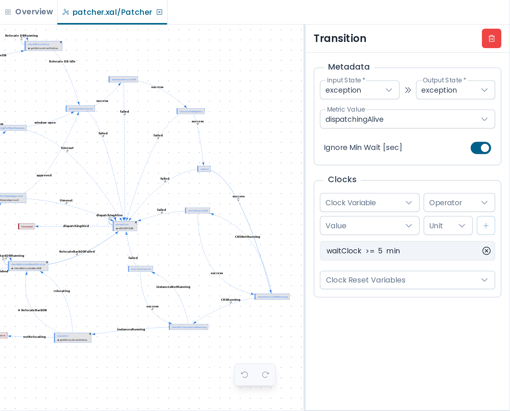

# Metric Value and Clocks

The **Metric Value** field and the **Clocks** section of the transition panel decide when a transition fires. You can use them alone or together.

/// caption
Fig.1 - A self-loop on exception: Metric Value, Ignore Min Wait and a clock constraint
///

---

## Metric Value

The **Metric Value** is the value the metric of the input state must return for the transition to fire. It is available on a Transition, not on a TransitionNew.

Choose it from the list. The options are the values declared on the metric of the input state (see [Configuring State Metrics](../states/metrics.md)). If the input state has no metric, or its metric declares no values, the list is empty.

Without a Metric Value, the transition does not look at the metric: it fires as soon as its clock constraints hold.

!!! warning
    Two transitions from the same input state cannot have the same Metric Value and the same clock constraints: the automaton could not tell which one to take. In that case the field shows **Metric value already in use**.

---

## Clock constraints

A clock constraint makes the transition wait for, or stop waiting after, a given time. It compares a clock of the automaton with a value: `waitClock >= 5 min` holds once five minutes have passed since `waitClock` was last reset.

To add one, in the **Clocks** section:

1. choose the **Clock Variable**: the clocks of the automaton (see [Clock Variables](../automata/clocks.md));
2. choose the **Operator**: `<`, `<=`, `>` or `>=`;
3. in **Value**, type a whole number, or choose a Global State of the automaton to compare with its value;
4. optionally choose the **Unit**: `sec`, `min` or `hour`. Without a unit, the value is in seconds;
5. click **+**.

The **+** button stays disabled until clock, operator and value are set. A value that is neither a number nor a Global State shows **Value must be a number or a global state**.

The constraint appears below as a chip; a Global State in it shows its icon. To remove a constraint, click **×** on its chip.

A transition can have several clock constraints: all of them must hold at the same time.

---

## Clock Reset Variables

**Clock Reset Variables** lists the clocks to restart from zero when the transition fires. Choose one or more clocks of the automaton; each one appears as a tag you can remove.

Reset a clock on the transition that enters the waiting phase, and constrain it on the transitions that leave it.

---

## Ignore Min Wait

The **Ignore Min Wait** switch lets the transition fire without waiting for the min wait of the automaton. See [Min Wait and Ignore Min Wait](types.md#min-wait-and-ignore-min-wait).

---

## Combining conditions

When a transition has both a Metric Value and clock constraints, both must hold: the metric has returned that value, and all constraints are met.

A common pattern is the timeout: one transition handles the expected value, another leaves the state when a clock exceeds a limit. In Fig.1 the self-loop on **exception** fires only when the metric returns `dispatchingAlive` and `waitClock` has reached five minutes.
