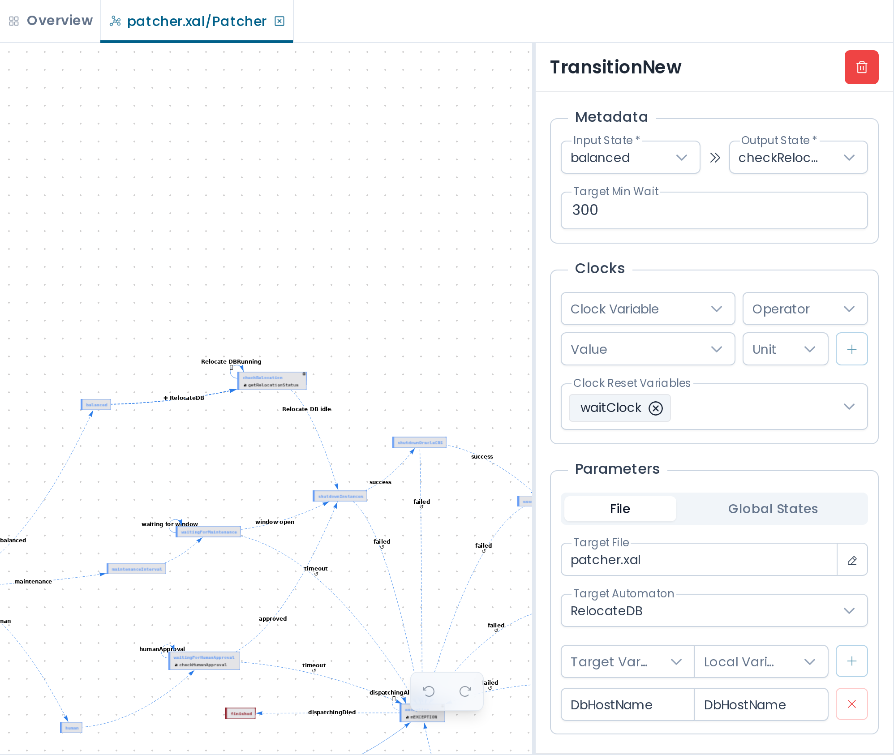

# Istanziare Automi Figli (TransitionNew)

Una **TransitionNew** fa due cose quando scatta: sposta l'automa nello stato di output e avvia un nuovo **automa figlio**. È così che si costruiscono le famiglie di automi.

---

## Creare una TransitionNew

1. Crea una transizione come al solito (vedi [Creare una transizione](creating.md)).
2. Nella sezione **Parameters**, imposta il **Target File** e il **Target Automaton**.

Appena sono impostati entrambi, il titolo del pannello diventa **TransitionNew**. Se compili anche la riga del ciclo, diventa una **TransitionNewMulti** (vedi [sotto](#un-figlio-per-ogni-elemento-transitionnewmulti)).

La scelta si fa mentre crei la transizione: una Transition già salvata non mostra la sezione Parameters.


/// caption
Fig.1 - Una TransitionNew che avvia RelocateDB da patcher.xal e gli passa DbHostName
///

---

## Target File

Il **Target File** è il file XAL che contiene l'automa figlio. Con il selettore sopra il campo scegli da dove viene:

- **File**: scegli dalla lista un file `.xal` del repository. Fai clic sulla **matita** per scriverne il nome.
- **Global States**: scegli un Global State dell'automa corrente. Quando la transizione scatta, il file è il valore che quella variabile ha in quel momento. Usa una variabile di tipo stringa.

Il figlio può stare anche nello stesso file del padre.

---

## Target Automaton

Scegli l'automa da avviare dalla lista **Target Automaton**. Le opzioni sono in due gruppi:

- **Automatons**: gli automi del Target File;
- **Global States**: i Global State dell'automa corrente. Quando la transizione scatta, l'automa è quello che ha per nome il valore della variabile.

Il campo è obbligatorio: senza, il pannello mostra **A target automaton is required**.

---

## Target Min Wait

**Target Min Wait** è il min wait del figlio, in secondi: il tempo minimo che il figlio passa in ciascuno dei suoi stati prima di poterne uscire. Lascialo vuoto o a 0 per nessuna attesa.

Vedi [Min Wait e Ignore Min Wait](types.md#min-wait-e-ignore-min-wait).

---

## Parametri di input

I parametri di input copiano valori dal padre al figlio quando il figlio parte. Ogni riga accoppia due variabili:

| Campo | Descrizione |
|---|---|
| **Target Variable** | Il Global State del figlio che riceve il valore. Le opzioni sono i Global State del Target Automaton. |
| **Local Variable** | Il Global State del padre da cui si legge il valore. |

Se il Target Automaton viene da un Global State, il designer non può conoscere le variabili del figlio e la lista di Target Variable è vuota: scrivi il nome.

Per aggiungere una riga, scegli le due variabili e fai clic su **+**. Per toglierla, fai clic su **×**. Se ne compili una sola, il pannello avvisa **Select values for both fields**.

Il valore si copia una volta sola, quando il figlio parte: le modifiche successive nel padre non arrivano al figlio.

!!! info
    Il figlio deve dichiarare la Target Variable nel proprio Global State, con un tipo compatibile con la Local Variable. Altrimenti il valore non passa.

---

## Un figlio per ogni elemento (TransitionNewMulti)

Una **TransitionNewMulti** avvia un figlio per ogni elemento di una lista. Compila la riga del ciclo dei parametri di input:

| Campo | Descrizione |
|---|---|
| **Loop Local Variable** | Un Global State di tipo lista del padre. |
| **Loop Target Variable** | Il Global State di ogni figlio che riceve il suo elemento della lista. |

Quando la transizione scatta, la lista viene letta e parte un figlio per ogni elemento. Tutti i figli ricevono anche i parametri di input normali, e tutti usano lo stesso Target Min Wait.

In una TransitionNewMulti i due campi del ciclo sono obbligatori: se uno è vuoto, il pannello mostra **Loop variables are required**.

---

## Avviare più di un figlio

Ogni TransitionNew avvia un figlio (o uno per elemento, per una TransitionNewMulti). Per avviare figli diversi, metti le TransitionNew in fila attraverso gli stati: per esempio una da `A` a `B` che avvia il primo figlio e una da `B` a `C` che avvia il secondo.

!!! warning
    Non dare a uno stato due transizioni che possono scattare nello stesso momento, per esempio due TransitionNew senza vincoli Clock. L'automa non sa scegliere tra le due e si ferma con un errore.

---

## Seguire il figlio

Dopo l'avvio, il padre segue il figlio con una [Metric](../states/metrics.md). La sua query legge il Global State del figlio dalla tabella del figlio, `<FileName>_<AutomatonId>`, filtrata per `groupLabel`:

```sql
SELECT GLOBALSTATE_STATUS FROM patcher_RelocateDB WHERE groupLabel = 'this.GROUPLABEL'
```

Quando il figlio arriva nello stato che il padre aspetta, la Metric restituisce il valore corrispondente e scatta la transizione del padre. Per i nomi delle tabelle e il legame con `groupLabel`, vedi [Sintassi delle query](../../reference/queries.md).

Per lo schema completo, vedi [Famiglie di automata](../../concepts/families.md).

---

## Nel canvas

Una TransitionNew è una **freccia tratteggiata** con l'etichetta **✚** e il nome dell'automa avviato. Una TransitionNewMulti mostra **✚✚**. Vedi [I tipi di transizione nel canvas](types.md#i-tipi-di-transizione-nel-canvas).
