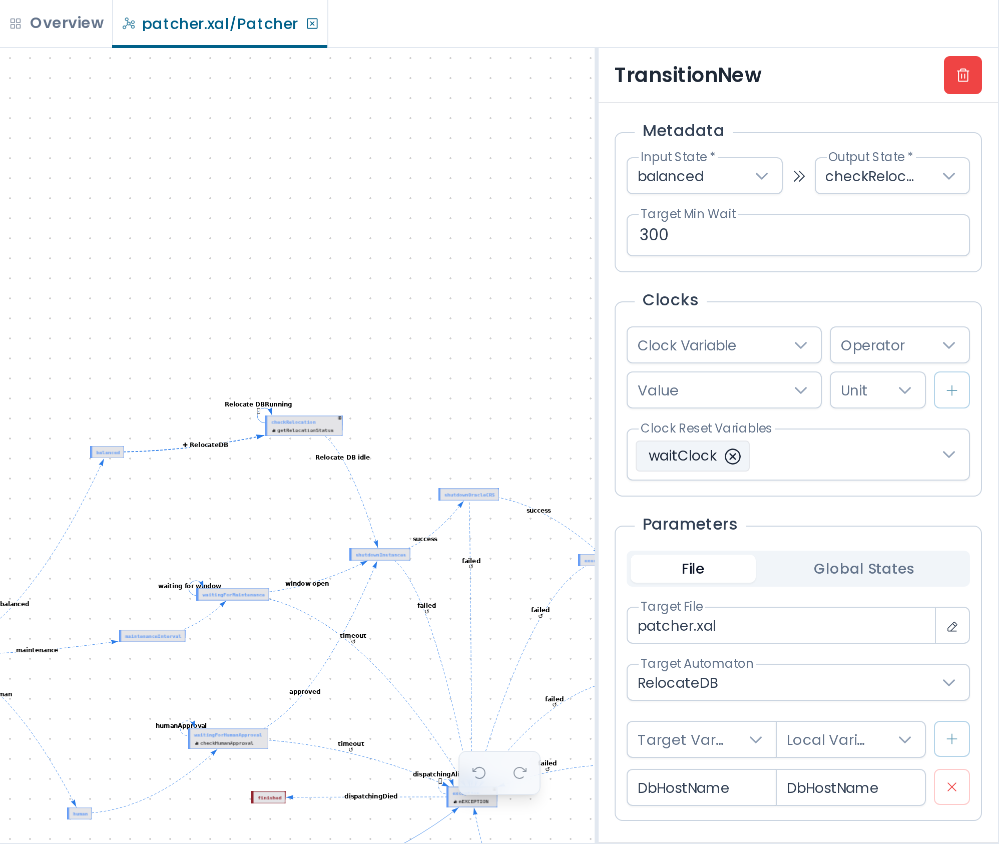

# Spawning Child Automata (TransitionNew)

A **TransitionNew** does two things when it fires: it moves the automaton to the output state, and it starts a new **child automaton**. This is how you build automaton families.

---

## Creating a TransitionNew

1. Create a transition as usual (see [Creating a Transition](creating.md)).
2. In the **Parameters** section, set the **Target File** and the **Target Automaton**.

As soon as both are set, the panel title becomes **TransitionNew**. If you also fill in the loop row, it becomes a **TransitionNewMulti** (see [below](#starting-one-child-per-item-transitionnewmulti)).

You choose this while you create the transition: a saved Transition does not show the Parameters section.


/// caption
Fig.1 - A TransitionNew that starts RelocateDB from patcher.xal and passes it DbHostName
///

---

## Target File

The **Target File** is the XAL file that contains the child automaton. Use the switch above the field to choose where it comes from:

- **File**: pick a `.xal` file of the repository from the list. Click the **pencil** to type the name instead.
- **Global States**: pick a Global State of the current automaton. When the transition fires, the file is the value that variable holds at that moment. Use a string variable.

The child can also be in the same file as the parent.

---

## Target Automaton

Choose the automaton to start from the **Target Automaton** list. The options are in two groups:

- **Automatons**: the automata of the Target File;
- **Global States**: the Global States of the current automaton. When the transition fires, the automaton is the one named by the value of that variable.

The field is required: without it the panel shows **A target automaton is required**.

---

## Target Min Wait

**Target Min Wait** is the min wait of the child, in seconds: the minimum time the child spends in each of its states before it can leave it. Leave it empty or at 0 for no wait.

See [Min Wait and Ignore Min Wait](types.md#min-wait-and-ignore-min-wait).

---

## Input parameters

The input parameters copy values from the parent to the child when the child starts. Each row pairs two variables:

| Field | Description |
|---|---|
| **Target Variable** | The Global State of the child that receives the value. The options are the Global States of the Target Automaton. |
| **Local Variable** | The Global State of the parent the value is read from. |

If the Target Automaton comes from a Global State, the designer cannot know the child's variables and the Target Variable list is empty: type the name.

To add a row, choose both variables and click **+**. To remove a row, click **×**. If you fill in only one of the two, the panel warns **Select values for both fields**.

The value is copied once, when the child starts: later changes in the parent do not reach the child.

!!! info
    The child must declare the Target Variable in its own Global State, with a type compatible with the Local Variable. Otherwise the value is not passed.

---

## Starting one child per item (TransitionNewMulti)

A **TransitionNewMulti** starts one child for each item of a list. Fill in the loop row of the input parameters:

| Field | Description |
|---|---|
| **Loop Local Variable** | A list Global State of the parent. |
| **Loop Target Variable** | The Global State of each child that receives its item of the list. |

When the transition fires, the list is read and one child starts for each item. All children also receive the normal input parameters, and all of them use the same Target Min Wait.

On a TransitionNewMulti both loop fields are required: if one is empty, the panel shows **Loop variables are required**.

---

## Starting more than one child

Each TransitionNew starts one child (or one per item, for a TransitionNewMulti). To start different children, chain the TransitionNew through states: for example, one from `A` to `B` that starts the first child, and one from `B` to `C` that starts the second.

!!! warning
    Do not give a state two transitions that can fire at the same moment, for example two TransitionNew without clock constraints. The automaton cannot choose between them and stops with an error.

---

## Monitoring the child

After the start, the parent follows the child through a [Metric](../states/metrics.md). Its query reads the child's Global State from the child's table, `<FileName>_<AutomatonId>`, filtered by `groupLabel`:

```sql
SELECT GLOBALSTATE_STATUS FROM patcher_RelocateDB WHERE groupLabel = 'this.GROUPLABEL'
```

When the child reaches the state the parent waits for, the Metric returns the matching value and the parent's transition fires. See [Query Syntax](../../reference/queries.md) for the table names and the `groupLabel` binding.

For the whole pattern, see [Automaton Families](../../concepts/families.md).

---

## On the canvas

A TransitionNew is a **dashed arrow** labeled **✚** and the name of the target automaton. A TransitionNewMulti shows **✚✚**. See [Transition types on the canvas](types.md#transition-types-on-the-canvas).
